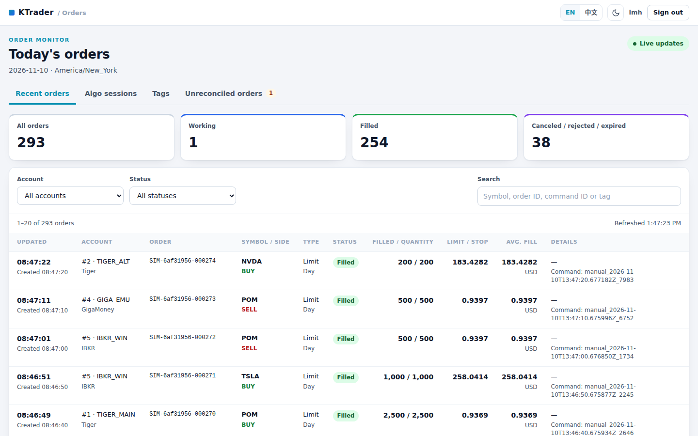
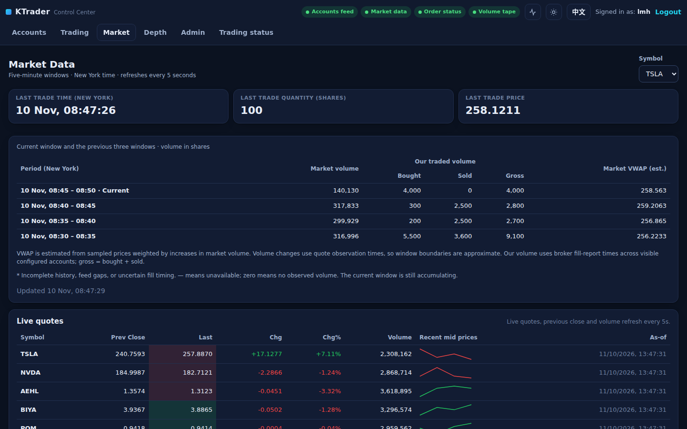
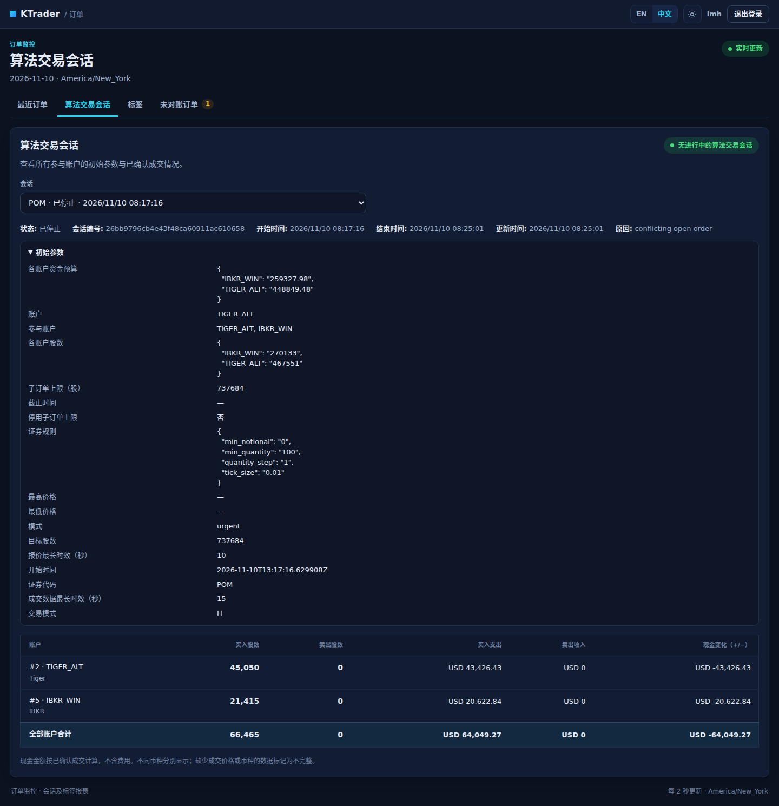
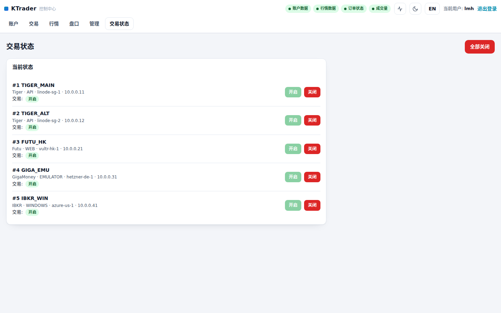
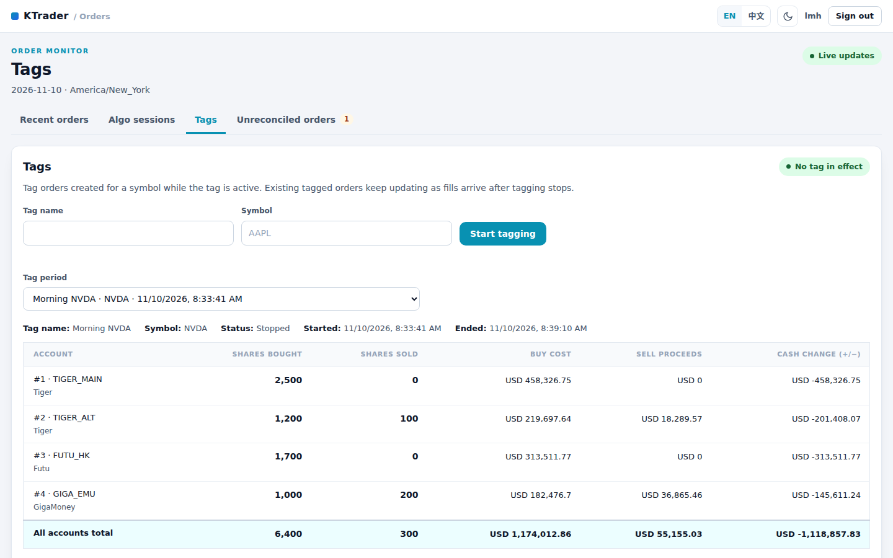

# nextgen-gui — KTrader control server and order monitor, rewritten in C++20

This repository replaces the two Python/FastAPI web services of
[mhliu94/KTrader](https://github.com/mhliu94/KTrader) with two static binaries:

* **`nextgen-gui`** replaces `trading_ui`: account details, the control panel (manual orders,
  fast-trading modes E/F, Smart selling G, Smart buying H), market data, market insights,
  Admin Control, trading status, the Kafka consumers/producer behind them, the operator
  reconciliation utilities, and a single-page web UI.
* **`nextgen-orders`** replaces `order_ui`: today's orders, algorithm-session and tag reports,
  and the Smart controllers' unreconciled records ([docs/ORDER_MONITOR.md](docs/ORDER_MONITOR.md)).

Both read the **same configuration file** and the **same Kafka topics and message schemas** as
the Python services, publish byte-compatible `trading-commands`, and open the existing SQLite
journals and report database, so they drop in where `start_trading_ui.sh` and
`start_order_ui.sh` used to run. The port follows KTrader up to commit `fec87a3`
(November 2026).

The Tiger/Futu listeners in `trading_server/`, the market-data producers, `admin_ui/`,
`configurator_ui/` and the Tiger SDK export script `retrieve-all-orders.py` are not part of the
rewrite and keep working unchanged with these servers.



## Why C++

The control server is latency-sensitive glue between Kafka and a handful of browsers: it has to
parse every price-book/account snapshot the instant it arrives, keep the Smart controllers' 1 Hz
loops punctual while the HTTP side is busy, and never stall under a burst. The C++ build has no
interpreter lock, keeps all state in memory behind fine-grained locks, pushes UI updates over a
single multiplexed event stream instead of re-rendering HTML per client, and links
librdkafka/SQLite statically. Measured against the Python service on the same box
([docs/BENCHMARK.md](docs/BENCHMARK.md)): 80–180× the HTTP throughput with sub-millisecond p99
latencies, 25 MB resident instead of 155 MB, a fraction of the CPU per ingested Kafka message,
and 192 simulated browser sessions (288 live streams, orders and algorithm starts included)
served without a single error at under 40 % of one core.

## Quick start (fresh Linux box)

```bash
git clone <this repository> ~/nextgen-gui
cd ~/nextgen-gui
./scripts/bootstrap.sh            # installs g++/cmake/ninja/openssl headers via apt/dnf/zypper/apk/pacman, builds, runs tests
cp config/config.example.json config/config.local.json
cp config/trading_accounts.example.json config/trading_accounts.json
$EDITOR config/config.local.json  # passwords, Kafka bootstrap servers, symbols
./scripts/start_nextgen_gui.sh    # control server: HTTPS on :443 (self-signed cert) + HTTP->HTTPS redirector on :80
./scripts/start_nextgen_orders.sh # order monitor: HTTPS on :8030 (same certificate)
```

Only a C++20 compiler (GCC 11 or newer; built and tested with GCC 11.5 and 15.2), CMake 3.22+,
OpenSSL headers and optionally zlib headers are needed from the system. librdkafka, SQLite,
cpp-httplib, nlohmann/json and doctest are compiled from the vendored sources in
`third_party/`; the binaries link `libstdc++`/`libgcc` statically and only need the system
OpenSSL, zlib and libc at runtime.

Manual build:

```bash
cmake -S . -B build -G Ninja -DCMAKE_BUILD_TYPE=Release
cmake --build build -j"$(nproc)"
./build/nextgen-tests             # 395 test cases, including Kafka round-trips on an in-process mock cluster
./build/nextgen-gui --check-config --config config/config.local.json
./build/nextgen-orders --check-config --config config/config.local.json
```

Useful CMake options: `-DNG_ENABLE_LTO=ON` (link-time optimisation),
`-DNG_STATIC_LIBSTDCXX=OFF`, `-DNG_BUILD_TESTS=OFF`.

## Running

`scripts/start_nextgen_gui.sh` understands the same environment variables as the Python
`start_trading_ui.sh` (`ACCOUNT_DASHBOARD_CONFIG`, `UI_HOST`, `UI_PORT`, `UI_SSL_ENABLED`,
`UI_SSL_CERTFILE`, `UI_SSL_KEYFILE`, `UI_TLS_NAME`, `UI_REDIRECT_*`, `KAFKA_*` including
`KAFKA_MARKET_DATA_REPLAY_RECORDS`, `MARKET_INSIGHTS_MAX_LEVELS`, `OPERATIONS_LOG_DIR`),
generates a self-signed certificate when TLS is on, stops a previous instance, and `exec`s the
binary. `scripts/start_nextgen_orders.sh` does the same for the order monitor with the
variables of `start_order_ui.sh` (`ORDER_UI_CONFIG`, `ORDER_UI_HOST`, `ORDER_UI_PORT`,
`ORDER_UI_SSL_ENABLED`, `ORDER_UI_SSL_CERTFILE`, `ORDER_UI_SSL_KEYFILE`), validating the
configuration before it replaces an instance on the same port. Run either with `--foreground`
from systemd. The binaries take:

```
nextgen-gui [--config PATH] [--host HOST] [--port PORT] [--ssl|--no-ssl]
            [--ssl-certfile PATH --ssl-keyfile PATH]
            [--redirect-port PORT --redirect-host HOST --redirect-target HOST]
            [--threads N] [--static-dir DIR] [--without-kafka] [--check-config]
            [--persist-orders [--date YYYY-MM-DD]] [--version]
nextgen-gui reconcile-prior-day --config PATH --reason TEXT [--apply --backup-dir DIR]
nextgen-gui reconcile-stopped-child --state-db PATH --feedback-db PATH --client-order-id ID
                                    --snapshot-file FILE --source REF [--apply]

nextgen-orders [--config PATH] [--host HOST] [--port PORT]
               [--ssl-certfile PATH --ssl-keyfile PATH | --no-ssl]
               [--static-dir DIR] [--without-kafka] [--check-config] [--version]
```

`--static-dir web/static` serves the UIs from disk instead of the copies embedded in the
binaries (handy while editing them). `--without-kafka` starts a UI with no broker for demos.
The two `reconcile-*` utilities preview by default and are described in
[docs/RECONCILIATION.md](docs/RECONCILIATION.md). `LOG_LEVEL=DEBUG|INFO|WARNING|ERROR` controls
logging; everything goes to stderr in the same `timestamp LEVEL [logger] message` layout as
before, so `journalctl` output is unchanged.

### systemd

```bash
sudo cp deploy/nextgen-gui.service deploy/nextgen-orders.service /etc/systemd/system/
sudo systemctl daemon-reload
sudo systemctl enable --now nextgen-gui nextgen-orders
journalctl -u nextgen-gui -u nextgen-orders -f
```

Edit `User`, `WorkingDirectory` and `ExecStart` in the units if the checkout is not
`/home/ubuntu/nextgen-gui`; environment overrides go into `/etc/nextgen-gui.env` and
`/etc/nextgen-orders.env`. Both services must run on the same host: they share the report
database and the order monitor reads the Smart controllers' state databases.

## Configuration

The configuration is the Python services' `config.local.json`, unchanged — see
[config/config.example.json](config/config.example.json). Resolution order:
`--config`, `$ACCOUNT_DASHBOARD_CONFIG` (`$ORDER_UI_CONFIG` first for the order monitor),
`./config/config.local.json`, `./config/config.json`. Relative paths inside the file
(`accounts_file`, `publisher_config`, `state_db`, `db_path`, TLS files) resolve against the
config file's directory, exactly as before.

| Section | Notes |
| --- | --- |
| `accounts_file` / `accounts` | `trading_accounts.json` (also written by `configurator_ui`); accounts with `"hidden": true` are skipped everywhere except the minute system snapshots |
| `symbols` | Market symbols; `market_data.market_insights_max_levels` caps the ladder depth |
| `market_data.publisher_config` | Optional path to the market-data producer's `md_producer_config.json`; its `symbols` list drives the Market Data page |
| `auth.users` | Plain-text logins, unchanged: `admin` and `trader` are mandatory, further users (such as `lmh`) are optional. Only `lmh` sees Market Data and Admin Control and may change trading status, exactly as in the original |
| `server` | `host`, `port`, `ssl_enabled`, `ssl_certfile`, `ssl_keyfile` (env `UI_*` fills gaps; `UI_SSL_ENABLED` wins over the file) |
| `kafka` | Control cluster + market-data cluster bootstrap servers, topics, group ids, offset resets, `market_data_replay_records` (default 100), producer settings, optional `client_config` / `market_data_client_config` with raw librdkafka properties (`security.protocol`, `sasl.*`, `ssl.*`) |
| `smart_selling` | Journal path, order-status/trading-volume topics (and optional separate bootstrap servers), freshness limits, participation percentages for patient/normal/urgent/ultra (6/12/20/30 by default), instrument rules (minimum 100 shares) |
| `smart_buying` | The same settings for mode H with its own journal; rates are fixed at 5/8/15 % ([docs/SMART_BUYING.md](docs/SMART_BUYING.md)) |
| `reporting` | Only `db_path` (default `reports/activity.sqlite3`): algorithm sessions, tags, order history for reports, market-data samples and minute system snapshots, shared by both servers |
| `fast_trading` | Aggression levels and per-medium minimum cycle seconds for modes E/F |
| `order_ui` | The order monitor's time zone, refresh interval, listener and Kafka settings ([docs/ORDER_MONITOR.md](docs/ORDER_MONITOR.md)) |
| `persistence` | `order_archive` (dir, timezone, daily_at, topic) and `account_snapshots` (dir, interval_seconds, formats); see Persistence below |

Validation errors produce the same messages as the Python loaders
(`accounts_file ... not found`, `Smart buying and Smart selling require separate state
databases`, `Unknown order_ui setting(s): ...`, ...).

## Architecture

```
src/core          Decimal (exact int128 arithmetic with Python's rounding digits), config loader,
                  i18n (EN/ZH table from the Python service + UI strings), logging, time zones,
                  strings, SQLite wrapper
src/model         Account snapshots, market-data stores (quotes with previous close and volume,
                  20-level books)
src/kafka         RAII librdkafka wrappers; account-details / price-books+stock-quotes consumers
                  with bounded replay and quote history; trading-commands producer with delivery
                  tracking; replay-gated order-status and trading-volume feeds for G and H
src/orders        Command builders and validators (MARKET/LIMIT/LIMIT_FOK/CANCEL/GET_BROKER_ORDERS/
                  trading-status/algo start+stop), identical ids and payloads; order-status schema
src/algo          The algorithm trading modes, kept apart from the plumbing:
  fast_trading/     Modes E/F: concurrent sessions, cycle planner, total target position,
                    cooldowns, reservations, auto-stop, operations log
  smart_selling/    Mode G: durable volume-participation engine (same SQLite schema and JSON
                    ledger layout as the Python engine), market adapter, order-status feedback,
                    runtime with 1 Hz heartbeat and single publisher worker
  smart_buying/     Mode H: the buy-side engine and runtime on the same ledger, cash budgets
src/reporting     Activity reports (sessions, commands, orders, tags), market-data windows,
                  minute system snapshots — the shared report database
src/ops           Operations log, end-of-day order archive, holdings recorder, reconciliation
src/web           Session store, control center (all views and command paths), event hub
                  (coalesced SSE fan-out), HTTP server (cpp-httplib, TLS, legacy form endpoints,
                  JSON API, SSE multiplex)
src/order_ui      The order monitor: configuration, order store, order-status consumer,
                  unreconciled view, HTTP server; src/orders_main.cpp is its entry point
web/static        Control-center SPA; web/static/orders/ the order monitor (vanilla JS, no build
                  step, no inline code); both embedded into the binaries
tests/            doctest suite: unit tests, HTTP tests on live servers, Kafka tests on
                  librdkafka's mock cluster; tests/algo/ holds the ports of the Python
                  fast-trading, Smart selling and Smart buying suites
tools/algo_oracle Differential test drivers (C++ and Python) and the random scenario diff
tools/bench       Kafka feeder with a simulated broker, HTTP/SSE/Kafka benchmark, browser stress test
tools/make_cjk_font.py  Rebuilds the embedded Chinese fallback font from the strings in use
```

Threads at runtime (control server): one HTTP acceptor + worker pool (`--threads`, default
`max(16, 4 × cores)`), one thread per Kafka consumer (account-details, market-data, the G and H
order-status and trading-volume feeds, the market-data order feed), the producer's
delivery-report thread, the Smart controllers' heartbeat and publisher threads, the minute
snapshot recorder, a 1 Hz status notifier, and one worker per running fast session. The order
monitor adds an HTTP pool and one consumer. All of that comfortably fits a 6c/12t box.

## Web UI

The control center is a single page served for every route (`/account-details`,
`/control-panel`, `/market-data`, `/market-insights`, `/admin-control`, `/trading-status`,
`/login`). It keeps the previous navigation and forms but renders client-side from JSON and a
single multiplexed `text/event-stream` (`/api/stream`), so a price-book burst costs one
coalesced event per client instead of a re-rendered HTML document. Features: dark/light theme,
EN/中文 toggle (`lang` cookie shared with the order monitor, `?lang=` links honoured), live
feed-health pills and health dialog, account cards with per-account Market/Limit order modals
and portfolio totals, fast-trading (E/F, with total target position and 120/150 % targets),
Smart selling (G, with ultra urgency and the child-cap switch) and Smart buying (H) launchers
with confirmation, the active-algorithm tables with stop/stop-all, sparklines on the quotes
table, the five-minute Market Data dashboard and Admin Control broker-history requests for
`lmh`, and a bid/ask ladder with depth selector on market insights. Legacy form posts still
work and surface their `?ok=`/`?err=` results as toasts.

Both UIs are responsive: on phones the top bars collapse, tab rows scroll, KPI tiles go two-up,
cards and forms stack, dialogs become bottom sheets, and the order monitor turns every table
row into a labelled card. An 84 KB subset of Noto Sans CJK SC (regenerated by
`tools/make_cjk_font.py` from every Chinese string the UIs can show) is embedded as a
last-resort font so Chinese renders even on machines without a Chinese system font.

| | |
| --- | --- |
|  |  |
|  |  |

## Verification

* `build/nextgen-tests` — 395 doctest cases (9,777 assertions): unit tests for every module,
  ports of the Python suites (fast trading, Smart selling engine/market/feedback/runtime,
  Smart buying, order limits, reporting, market activity, system snapshots, reconciliation,
  order monitor), time zones against Python's zoneinfo, HTTP tests against live servers, and Kafka tests against librdkafka's
  in-process mock cluster. The suite also builds and passes with GCC 11.5.
* `python3 tests/test_confirmations.py --browser /path/to/chromium` exercises Stop all,
  Cancel all orders, and Turn trading off in a headless browser, including cancellation,
  Escape, close-button, and backdrop dismissal. All API calls are mocked; it needs no
  running application, credentials, Kafka connection, or Python packages.
* **Differential tests against the original implementation.** `tools/algo_oracle/` drives the
  same randomly generated scenarios through this port (`nextgen-algo-driver`) and through the
  Python `trading_ui.services` code at `fec87a3`, then compares the traces step by step: every
  action the engines emit, every ledger field (`earned`, `free_credit`, `reserved`, `filled`,
  `discarded`, per-account inventory and cash, order state, fallback, reasons), market-adapter
  verdicts, feedback correlation and the fast-trading planner's output for modes E and F.

  ```bash
  python3 tools/algo_oracle/oracle_diff.py --cpp-driver build/nextgen-algo-driver \
      --python /path/to/venv/bin/python --repo /path/to/KTrader --count 400 --seed 2
  ```

  Last run: 700 scenarios / 26,000 compared steps for E, F, G and H, zero divergences.
* **Live demo.** `tools/bench/feeder.py --broker` runs a simulated market and broker on a local
  Kafka (books, quotes with previous close and volume, the volume tape, account snapshots that
  follow fills, order-status reports); both UIs were exercised against it in English and
  Chinese, on desktop and phone widths (screenshots in `docs/screenshots/`).

## Persistence

Two recorders write files, both locations configurable in the `persistence` section (and by
environment: `ORDER_ARCHIVE_DIR`, `ACCOUNT_SNAPSHOTS_DIR`).

**End-of-day order archive.** Once a day at `persistence.order_archive.daily_at` (local time of
`timezone`, default 17:00 America/New_York) the server reads the retained `order-status` topic
from its beginning, keeps every valid snapshot of orders *created* on that trading day, and
writes

```
<dir>/orders-<date>/orders-<date>.json      latest state per order + broker/medium + New York times
<dir>/orders-<date>/source-snapshots.json   every matching raw update with topic/partition/offset
```

in the layout of the daily files on the trading box. The run can also be triggered by hand or
from cron:

```bash
./build/nextgen-gui --persist-orders --config config/config.local.json            # today
./build/nextgen-gui --persist-orders --date 2026-10-21 --config config/config.local.json
```

**Account holdings snapshots.** Every `persistence.account_snapshots.interval_seconds`
(default 60, aligned to the wall clock) the holdings of every configured account — positions
with quantity, available quantity and average price, cash and available cash by currency,
trading state, and the age of the broker snapshot behind it — are appended to
`<dir>/holdings-<local date>.jsonl` and inserted into `<dir>/holdings.sqlite3`. Either format
can be switched off with `formats`.

**Report database** (`reporting.db_path`). Shared by both servers (SQLite WAL): algorithm
sessions with their starting parameters and correlated commands, order history for session
and tag reports, tags, market-data samples for the five-minute windows, and — as upstream —
a `system_snapshots` row every minute with the latest holdings and cash of every configured
account, hidden ones included:

```bash
sqlite3 reports/activity.sqlite3 'SELECT payload FROM system_snapshots ORDER BY id DESC LIMIT 1;'
```

`GET /api/health` reports all recorders under `persistence`.

## Compatibility notes

* Kafka messages in and out are unchanged; command ids keep the
  `cmd_|limit_|cancel_open_|broker_orders_|trading_status_|algo_|algo_stop_` formats.
* The Smart selling and Smart buying journals and their feedback stores are opened as-is; a
  parent started by the Python service is reconciled by this server after a restart, and vice
  versa. Each journal is `flock`ed so two servers cannot own it at once.
* Following upstream: Currency Conversion was replaced by Admin Control (`/currency-conversion`
  and `/api/fx` are gone); `/api/market-data` is now the `lmh`-only five-minute window API and
  the former quotes table moved to `/api/quotes`; several algorithm sessions may run at once
  on disjoint accounts.
* `/api/account-details/stream` emits JSON (`event: accounts`) rather than HTML fragments;
  every other JSON endpoint keeps its response shape. HTML is no longer rendered server-side,
  so anything that scraped the old templates must use the JSON API ([docs/API.md](docs/API.md)).
* `DELAYED_MARKET_ORDER` is not offered (it was already removed from the Python UI).

## Documentation

* [docs/MIGRATION.md](docs/MIGRATION.md) — moving a running Python deployment over.
* [docs/API.md](docs/API.md) — HTTP endpoints of both servers, payloads, SSE topics.
* [docs/ORDER_MONITOR.md](docs/ORDER_MONITOR.md) — the order monitor.
* [docs/SMART_BUYING.md](docs/SMART_BUYING.md), [docs/MARKET_DATA.md](docs/MARKET_DATA.md),
  [docs/ADMIN_CONTROL.md](docs/ADMIN_CONTROL.md) — features added upstream.
* [docs/RECONCILIATION.md](docs/RECONCILIATION.md) — the operator reconciliation utilities.
* [docs/BENCHMARK.md](docs/BENCHMARK.md) — measured C++ vs Python results and how to rerun.
