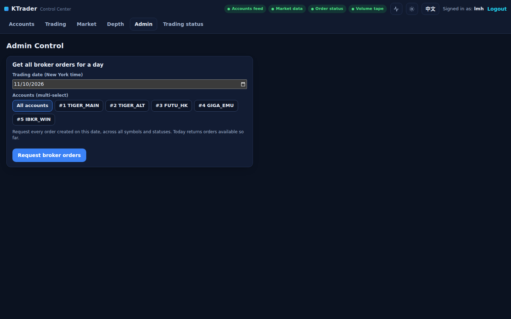

# Admin Control: broker order history requests

`/admin-control` replaced the Currency Conversion tab upstream; the old currency-conversion
page, form route and `/api/fx` are gone (404). Only the user `lmh` can open the page or
submit a request. Other signed-in users, `admin` included, get HTTP 403; anonymous visitors
are asked to sign in.



Pick a trading date (today or earlier in `America/New_York`) and one or more accounts, or
**All accounts**. The whole selection is validated before anything is published, and one
message goes out per submission: **All accounts** expands to the explicit list of configured
accounts at that moment, sorted by numeric id, with duplicates removed. Balances and
trading-enabled flags never exclude accounts. The request can be queued while algorithms
own the accounts: it is a history query, not a trading instruction.

| Route | Notes |
| --- | --- |
| `POST /api/broker-orders` | JSON or form: `trading_date`, `account_ids[]` (`__ALL__` for every account). `{"ok": true, "message": "Request queued for N account(s) on DATE ... published_cmd=...", "command": {...}}`; 400 for an invalid or future date or unknown account; 403 for other users; 503 when the producer is unavailable |
| `POST /submit-broker-orders` | The original form route: redirects back with `?ok=` / `?err=` |
| `GET /submit-broker-orders` | 405 — a history request is only ever queued by a POST |

## Kafka message

Topic `kafka.trading_commands_topic` (`trading-commands`), key `GET_BROKER_ORDERS`, value:

```json
{
  "type": "GET_BROKER_ORDERS",
  "command_id": "broker_orders_7a0b0938dbd746b08902ea90ef437102",
  "ts": "2026-11-09T13:30:00Z",
  "trading_date": "2026-11-05",
  "timezone": "America/New_York",
  "account_ids": ["GIGA-WJY", "TIGER-WJY"]
}
```

This multi-account message has no `account_id`, `broker` or `broker_id`; every broker
consumer matches its own accounts against `account_ids` and must receive the message through
its own consumer group. Brokers should return every order **created** between local midnight
of `trading_date` and the next local midnight in the named zone (25 hours on the November
daylight-saving day), across all symbols and statuses, exhausting pagination. The UI's
success message means the request was queued, not that the broker finished; the broker-side
query and result publication remain the broker scripts' job, as upstream.

## Tests

`build/nextgen-tests -sf="*test_web*"` (entitlements, validation, `__ALL__` expansion, the
published payload, the removed routes and the 405) and `-sf="*test_commands*"` (message
builder and date rules).
