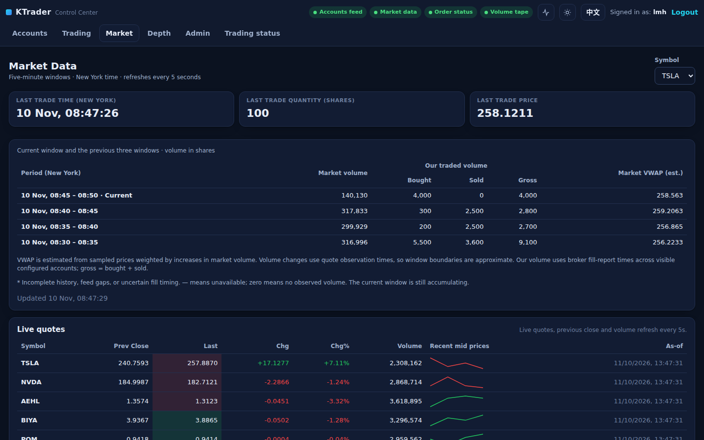

# Market Data: five-minute trading windows

Only `lmh` can open `/market-data` or call `GET /api/market-data?symbol=XYZ`; other signed-in
users get 403 and do not see the tab, anonymous API calls get 401, and responses are never
cached. Everyone keeps the live quotes used by the trading forms through `GET /api/quotes`.

The symbol list comes from `market_data.publisher_config` (the market-data producer's
`md_producer_config.json`, whose `symbols` must be a non-empty list) or, without it, from the
configured `symbols`. The page refreshes every five seconds and shows the last trade's time,
size and price, then four rows: the current clock-aligned five-minute window and the three
before it, newest first, all in New York time. Each row has market volume, our bought, sold
and gross volume, and an estimated market VWAP.

## How the numbers are measured

* `stock-quotes` carries sampled last-trade prices and the day's cumulative volume. Market
  volume in a window is the sum of increases of that counter between consecutive healthy
  samples; the VWAP estimate weights each sample's price by its volume increase. Last-trade
  size is shown but never counted as window volume.
* Bad samples, daily resets, negative corrections and gaps longer than 30 s break the chain,
  and a window without a complete chain is marked `*`. Last-trade fields disappear after 30 s
  without a healthy quote.
* Our volume covers every visible configured account and every source of orders (manual,
  E/F, G, H). An independent `order-status` consumer inside the control server stores
  cumulative fill snapshots by account, order and sequence; positive fill differences go to
  the window containing the broker's `updated_at`. Increases spanning a boundary and downward
  corrections mark the affected windows `*`. Duplicates never add volume.
* While the order feed is catching up or has skipped invalid messages, our figures are marked
  incomplete; `—` means unavailable, `0` means observed zero.

## Storage and startup

Samples live in `market_quote_samples` and `market_order_samples` in the shared report
database (`reporting.db_path`). One day is kept, plus an older baseline per order; cleanup
runs at most every five minutes. On partition assignment the market-data consumer asks Kafka
for the last 25 minutes of `stock-quotes` by timestamp (falling back to the record-count
replay bound `kafka.market_data_replay_records`, default 100), so the four windows fill
immediately after a restart.

## Tests

`build/nextgen-tests -sf="*test_market_activity*"` (window arithmetic, resets, gaps, stale
feeds, corrections, duplicates, account filtering, persistence) plus the quote-history replay
in `-sf="*test_kafka*"` and the entitlement checks in `-sf="*test_web*"`.
