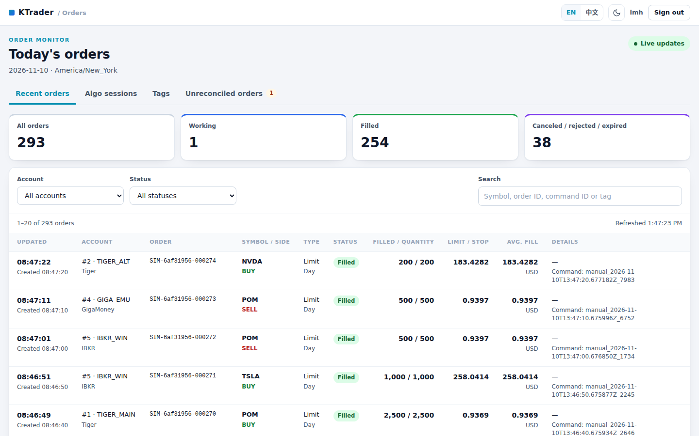
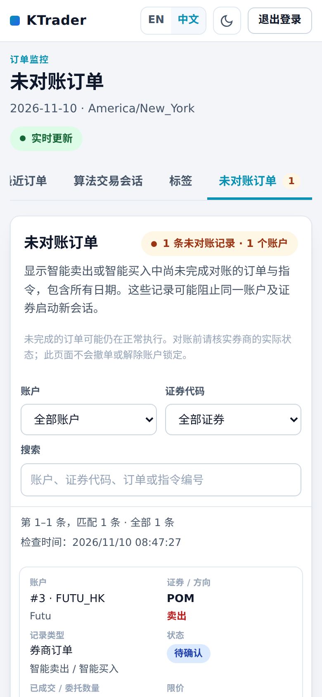

# Order monitor (`nextgen-orders`)

`nextgen-orders` is the C++ rewrite of KTrader's `order_ui`: a separate, read-only web server
that follows the `order-status` topic and shows today's orders, algorithm-session reports, tag
reports and the Smart controllers' unreconciled records. It cannot place, amend or cancel
orders. It runs next to `nextgen-gui` on its own port (8030 by default) and reads the same
configuration file.



## Run

```bash
./scripts/start_nextgen_orders.sh                 # HTTPS on 0.0.0.0:8030 with certs/server.crt|key
sudo cp deploy/nextgen-orders.service /etc/systemd/system/
sudo systemctl daemon-reload && sudo systemctl enable --now nextgen-orders
```

The launcher understands the variables of the Python `start_order_ui.sh`: `ORDER_UI_CONFIG`
(falls back to `ACCOUNT_DASHBOARD_CONFIG`, then `config/config.local.json`), `ORDER_UI_HOST`,
`ORDER_UI_PORT`, `ORDER_UI_SSL_ENABLED`, `ORDER_UI_SSL_CERTFILE`, `ORDER_UI_SSL_KEYFILE`. It
validates the configuration before replacing an instance that runs on the same port, never
touches the control server, and generates a self-signed certificate (for `ORDER_UI_TLS_NAME`)
only when neither certificate file exists. Put overrides in `/etc/nextgen-orders.env` under
systemd. The binary itself:

```
nextgen-orders [--config PATH] [--host HOST] [--port PORT]
               [--ssl-certfile PATH --ssl-keyfile PATH | --no-ssl]
               [--static-dir DIR] [--without-kafka] [--check-config] [--version]
```

`--host`, `--port` and the TLS options override `order_ui.server`; the control server's
`server` section and `UI_*` variables never affect this server. `--static-dir web/static`
serves the page from disk while editing it; `--without-kafka` shows the UI with no broker.

Sign in with any user in `auth.users`. Sessions last 12 hours and use their own cookie
(`ktrader_order_ui_session`), so signing in or out never disturbs a control-server session.
All users see all visible accounts, as in the control server. Sessions live in memory: run
one instance per port, or use sticky sessions behind a proxy.

## Configuration

Everything is optional; add an `order_ui` object to the shared configuration (see
[config/config.example.json](../config/config.example.json)):

| Setting | Default | Meaning |
| --- | --- | --- |
| `order_ui.timezone` | `America/New_York` | Zone that defines "today" (by order **creation** time) and the displayed times. Any IANA name works; zones other than the built-in America/New_York, UTC, Asia/Shanghai, Asia/Hong_Kong, Asia/Singapore and Asia/Tokyo are read from the system tz database (`tzdata`, or `$TZDIR`) |
| `order_ui.refresh_interval_seconds` | `2` | Browser polling period, 0.5–60 s |
| `order_ui.server.host` / `port` | `127.0.0.1` / `8030` | Listening address |
| `order_ui.server.ssl_certfile` / `ssl_keyfile` | empty | HTTPS files (both or neither), relative to the configuration file |
| `order_ui.kafka.bootstrap_servers` | shared `kafka.bootstrap_servers` | A separate order-status cluster |
| `order_ui.kafka.topic` | `order-status` | Topic carrying full order snapshots |
| `order_ui.kafka.group_id` | `order-dashboard` | Group **prefix**; every process adds a unique suffix and reads all partitions |
| `order_ui.kafka.poll_timeout_sec` | `1.0` | 0.1–5 s |
| `order_ui.kafka.client_config` | `{}` | librdkafka SASL/TLS settings: `security.protocol`, `sasl.mechanism(s)`, `sasl.username`, `sasl.password`, `ssl.ca.location`, `ssl.certificate.location`, `ssl.key.location`, `ssl.key.password`, `ssl.endpoint.identification.algorithm` (`*.location` paths resolve against the configuration file) |
| `reporting.db_path` | `reports/activity.sqlite3` | The report database shared with `nextgen-gui` |
| `smart_selling.state_db`, `smart_buying.state_db` | `logs/smart_selling.sqlite3`, `logs/smart_buying.sqlite3` | Read (only) by the unreconciled view, together with their `.feedback.sqlite3` companions |

Unknown keys are rejected with the original messages (`Unknown order_ui setting(s): ...`).
Relative default paths resolve against the working directory; both launchers run from the
checkout, so the two servers find the same files. Keep both servers on one host: the report
and state databases are local SQLite files (WAL mode), not a network transport.

## What the page shows

* **Recent orders** — every order created today in the configured zone, newest update first,
  with counts of working, filled and closed orders; filters by account and status; search by
  symbol, order id, command id, client order id, account or tag name; 10/20/50 rows per page.
  Midnight clears the table on the next poll. The feed pill and notices show Kafka state
  (connecting, replaying retained snapshots, live, interrupted) and skipped invalid messages.
* **Algo sessions** — fast trading (E/F), Smart selling (G) and Smart buying (H) sessions with
  their starting parameters (participation rates are never shown), lifecycle status, every
  selected account and confirmed executions: shares bought and sold, buy cost, sell
  proceeds and signed cash change per currency, plus an all-accounts total. A session whose
  heartbeat is older than 90 s shows "Status unavailable" instead of "Running".
* **Tags** — any signed-in user can start one tag at a time for a symbol and stop it later.
  Orders for that symbol *created* inside `[start, stop)` carry the tag in every view; fills
  arriving after the stop still update the tag's totals. Tags survive restarts.
* **Unreconciled orders** — the durable records that block a new Smart selling or Smart buying
  session on the same account and symbol, across all dates: broker orders without a final
  status, commands still waiting for a linked final report, and dispatched children a stopped
  controller still holds. Records known to both controllers appear once with both modes.
  The view is read-only; an unavailable database produces an "incomplete" warning, never an
  all-clear. [RECONCILIATION.md](RECONCILIATION.md) explains how to clear records.

Cash figures are gross executed value (`filled_quantity × average_fill_price`) before fees;
missing prices or currencies mark the amount incomplete instead of guessing. Higher order
sequences replace cumulative fills, so replays and corrections never double-count.

The page is available in English and Chinese (the `lang` cookie is shared with the control
server; `?lang=zh` overrides it), in light and dark themes, and on phones, where every table
row becomes a labelled card. No inline scripts or styles are used, so the strict
Content-Security-Policy holds.



## The order-status contract

Account listeners publish one full JSON snapshot per order whenever its status or fills
change (schema `order-status.v1`, unchanged: see `order_ui/schema/order-status.v1.schema.json`
and `order_ui/README.md` in the KTrader repository). The monitor validates every message with
the same rules: at most 64 KiB, no unknown fields, finite numbers, RFC 3339 timestamps with an
offset, `updated_at >= created_at`, `filled_quantity <= quantity`, `FILLED` fully filled,
`PARTIALLY_FILLED` positive and incomplete, a strictly increasing `sequence` per
`(account_id, order_id)`, immutable `created_at`, symbol and side, and an `account_num_id`
matching the configured account. Invalid messages are counted and skipped. Echo
`command_id` or `client_order_id` from the originating command so fills can be attributed to
an algorithm session.

On every start or partition assignment the consumer replays the topic from the beginning,
never commits offsets and shows "Loading retained order snapshots" until each partition has
been read to its end. Retain at least a trading day plus a restart margin on the topic.

## Tests

`build/nextgen-tests -sf="*test_order_ui*"` covers message validation, sequencing, rollover at
midnight and across daylight-saving changes, configuration errors, consumer replay with the
librdkafka mock cluster, sign-in, cookies, CSRF and CSP headers, tag rules, reports across
restarts and midnight, participation hiding, the unreconciled view's sources and
deduplication, and consistency between the page, its script and its translations.
